

  <picture>
    <source media="(prefers-color-scheme: dark)" srcset="assets/maguro-lockup-dark.png">
    <source media="(prefers-color-scheme: light)" srcset="assets/maguro-lockup-light.png">
    
  </picture>

<h1 align="center">Maguro</h1>

高速で軽量な、Windows 向けマルチペイン・ファイルマネージャ。 本物のエクスプローラーを、並べて。

> **Maguro は efww の [efww/grids](https://github.com/efww/grids) のフォークです。** 実行ファイル名（`maguro.exe`）、ウィンドウクラス、設定フォルダ、ホットキー（Win+Shift+E）が異なります。

  
  
  
  

  <a href="README.md">English</a> | 日本語 | <a href="README.ko.md">한국어</a>

  <a href="https://samek86.github.io/maguro/help/ja/">オンラインヘルプ</a>
  · <a href="https://samek86.github.io/maguro/help/">한국어</a>
  · <a href="https://samek86.github.io/maguro/help/en/">English</a>

  <picture>
    <source media="(prefers-color-scheme: dark)" srcset="docs/images-v3/hero_dark.ja.png">
    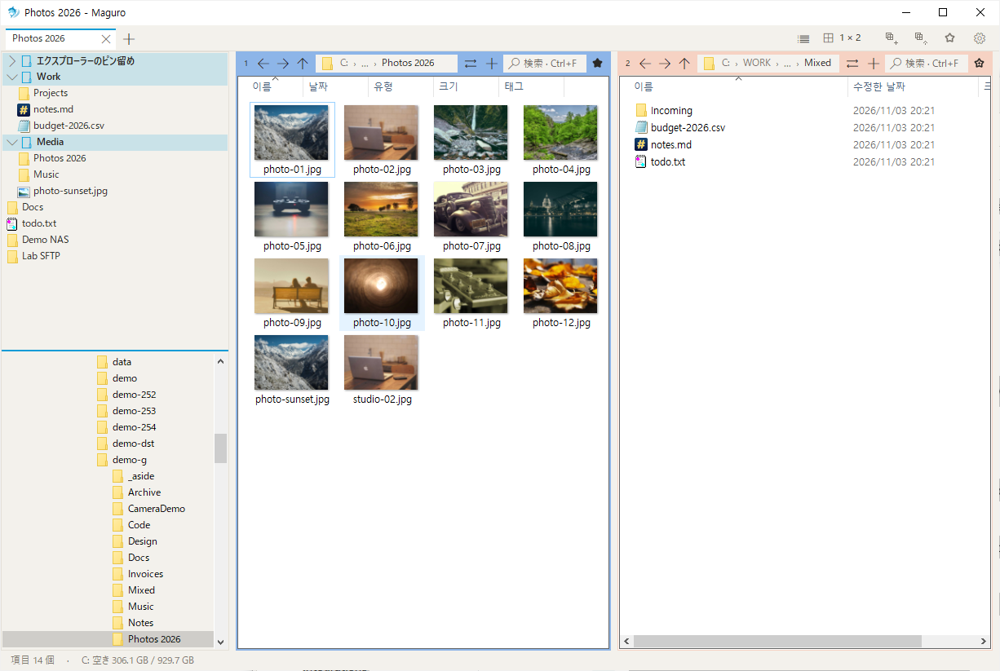
  </picture>

どのペインも本物の Windows エクスプローラーです。右クリックメニュー、ドラッグ＆ドロップ、サムネイル、Windows のコピーダイアログがそのまま動きます。新規インストールは **ペインひとつ** で開きます。仕事が広がったら格子を広げてください。最大 4×4、十六ペインです。

コピーと移動は **IFileOperation** です。Windows の進行状況、元に戻す、見慣れた競合の確認がそのまま使えます。ネットワーク転送は、必要なときだけ robocopy に切り替えられます。

## 一目で分かるレイアウト

レイアウトをクリックすると均等な格子になります。押したままドラッグすると、列ごとの行数を決められます。スプリッターをドラッグしてサイズを変え、ダブルクリックで等分します。ペインの見出しをダブルクリックするか Ctrl+Shift+M で、そのペインを最大化します。

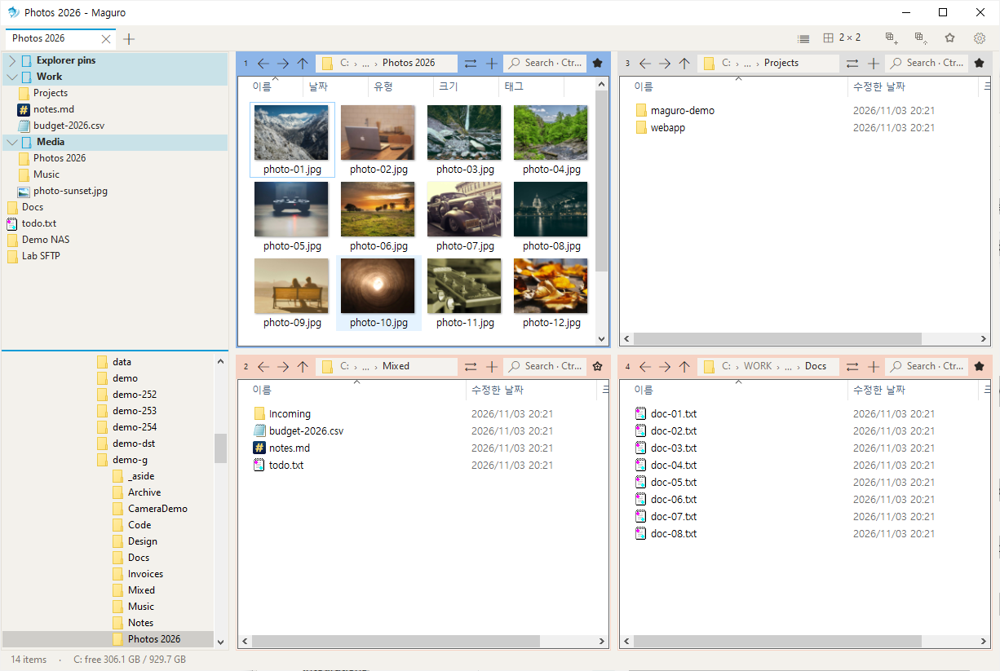

<table>
<tr>
<td>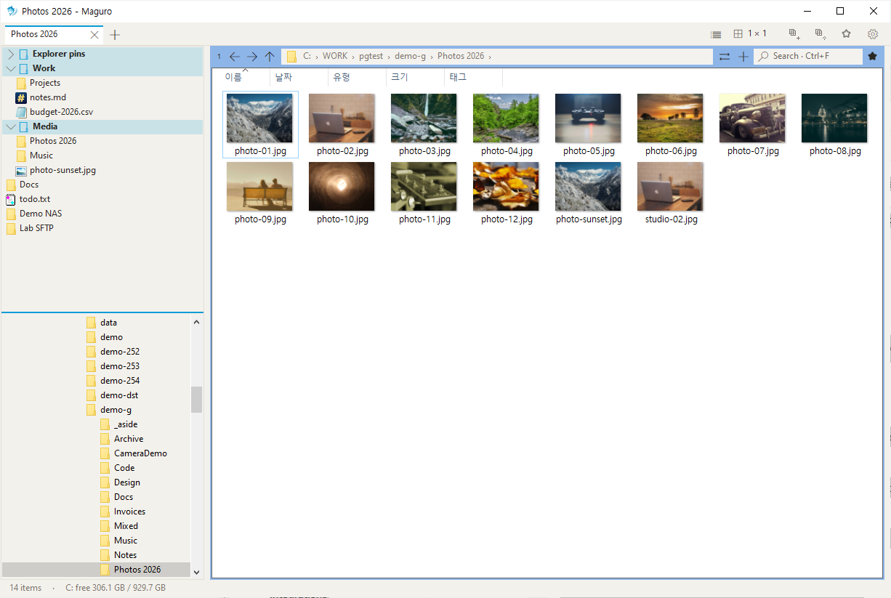</td>
<td>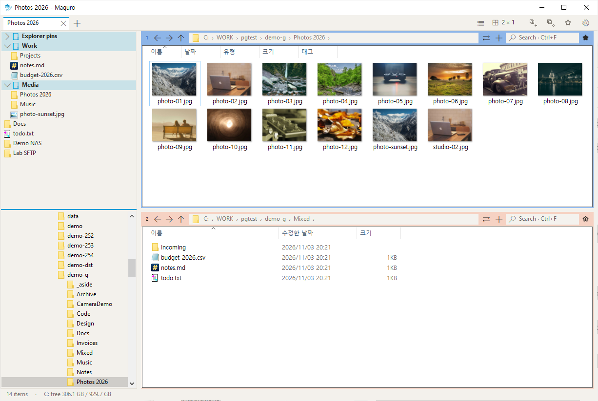</td>
<td>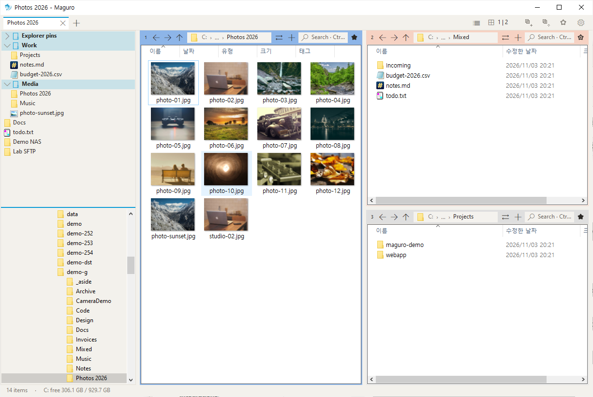</td>
</tr>
<tr>
<td>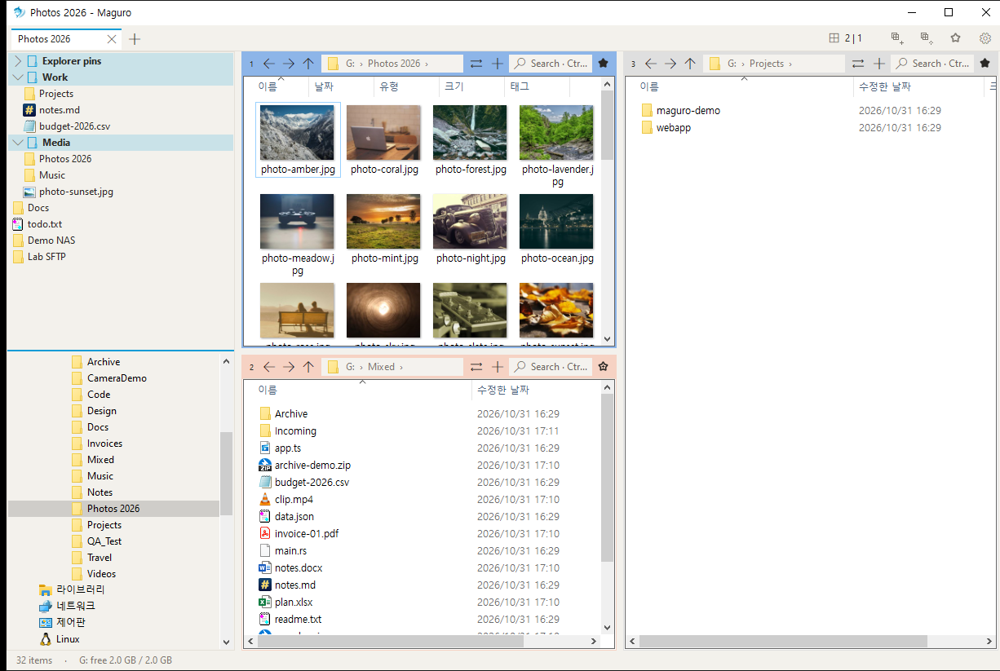</td>
<td>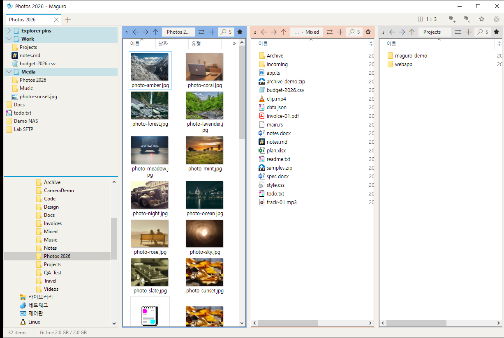</td>
<td>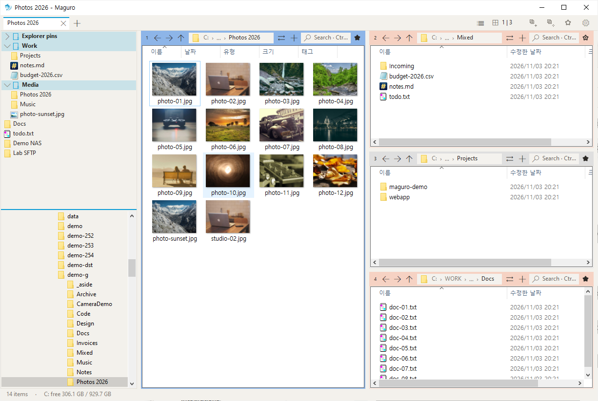</td>
</tr>
<tr>
<td>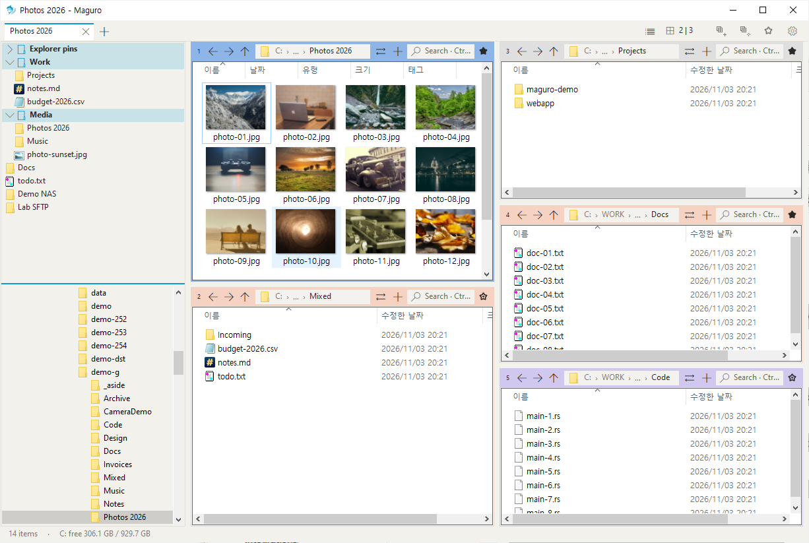</td>
<td>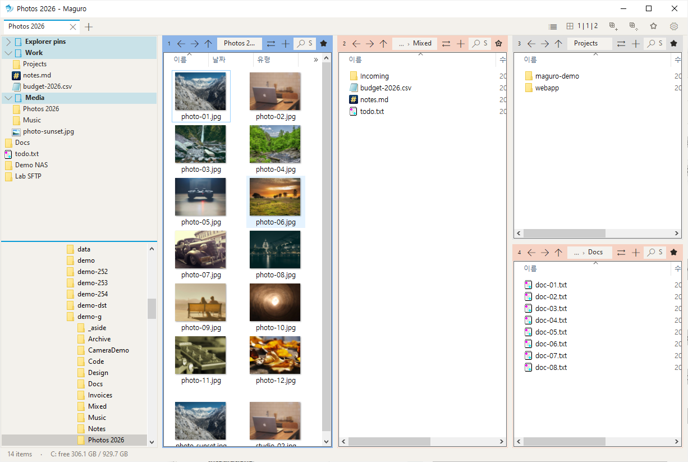</td>
<td>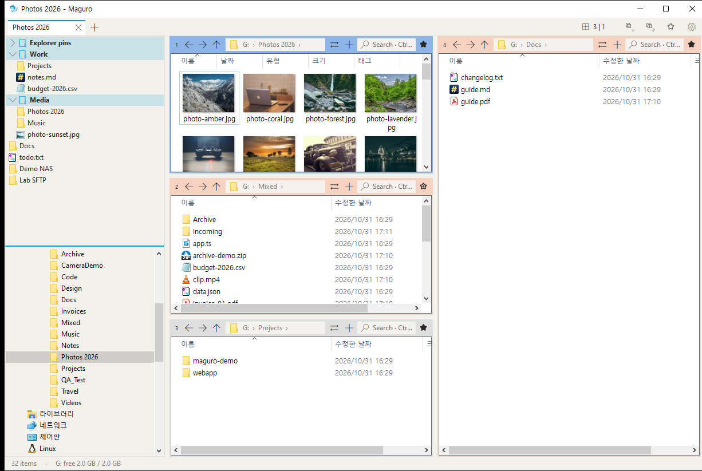</td>
</tr>
</table>

## タブ、セッション、タブ一覧

ウィンドウのタブはレイアウト全体を持ちます。ペイン、フォルダー、列、色ラベルまで。ペインタブは、ひとつのマスの中の追加フォルダーです。

**Ctrl+Shift+L** で、このウィンドウのタブ一覧が開きます。タブ名かフォルダーで絞り込めます。完全なパスも対象です。フォルダーのチップにカーソルを置くとそのパスが出て、**F2** でタブ名を変え、Enter で移動します。タブ列右端の一覧ボタンと、タブメニューの **タブ一覧…** も同じウィンドウです。

名前付きセッションは `maguro-sessions` の **`.maguro` ファイル** だけです。`.grids`、`.qdr`、`grids.ini` は開きません。

  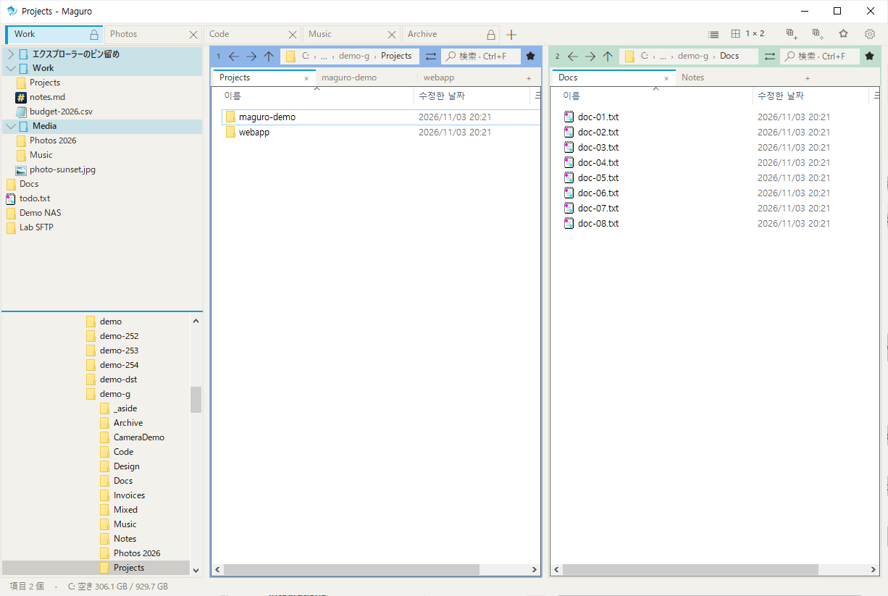
  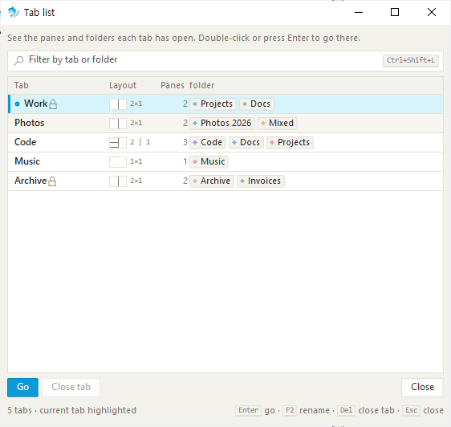

ペイン番号のバッジをドラッグして、別のペインと入れ替えます。ドラッグ中に **Ctrl** を押すと、そのペインを複製します。ペイン見出しの色で、コピー元とコピー先が分かります。

## 検索、プレビュー、リネーム

**Ctrl+F** は、入力に合わせてこのフォルダーを絞り込みます。サブフォルダーをオンにすると、起動中の [voidtools Everything](https://www.voidtools.com/) に問い合わせ、Everything が無いときはディスクを歩きます。Everything の結果は名前・パス・サイズ・更新日時の表です。列の境界をドラッグすると幅が変わり maguro.json に残ります。その境界をダブルクリックすると、その列が既定の幅に戻ります。結果にマウスを置くと、名前全体・フォルダ・正確なサイズ・日時が他のツールチップと同じ見た目で即座に出ます。

**Space** または **F3** でクイックルックが開きます。画像、PDF、Office、HTML、Markdown、コード、CSV、ZIP、HWP などを表示します。Ctrl+ホイールで 10% から 800% まで拡大します。左右の矢印でファイルを送られます。プレビューで **F2** は名前の変更、**Del** は削除です。

**Ctrl+Shift+R** で一括リネームが開きます。左にルールが積み上がります。置換、大文字小文字、番号、日付、正規表現など。右のライブプレビューは、確定する前に新しい名前と、衝突する名前をすべて見せます。元に戻すと、直前の一括処理が戻ります。

  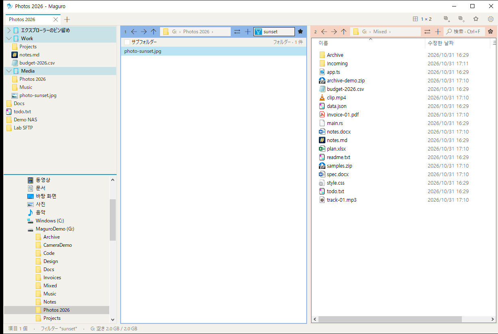
  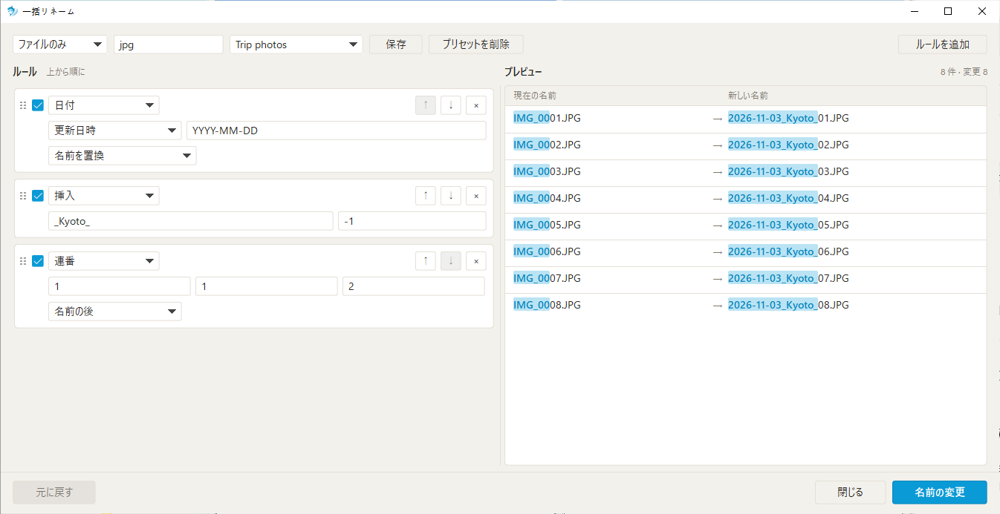

## Excel、コンテキストメニュー、Win+Shift+E

`.xlsx` または `.xlsm` を右クリックし、**A1・100%に整える** を選びます。選択は A1 に、ズームは 100% に戻り、最初のシートを選び、`.bak.xlsx` のバックアップを残せます。**読み取り専用で開く** は `.xls`、`.xlsx`、`.xlsm`、`.csv` を Excel の `/r` で開くので、共有ブックを他の人がロックしたままにしません。

ファイル一覧はエクスプローラーのメニューに、Maguro の行が加わります。Maguro のお気に入りに追加、一括リネーム、高速貼り付け、このファイルを使用中のプログラム。設定で、他社の項目と Windows 11 のパッケージコマンドを隠せます。お気に入りは左パネルのグループに置き、**Ctrl+B** でクイックリストが開きます。

**Win+Shift+E** は、Maguro の実行中ならどのアプリからでも Maguro を前面にします。もう一度押すと、単一ウィンドウモードでは新しいタブが開き、そのモードを切っていると最小化します。Win+E はエクスプローラーのままです。

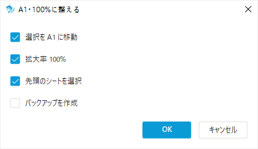

同じウィンドウに、ファイルバスケット、フォルダー監視、クリップボードのパスを開く（Win+Shift+V）、九つのワークスペース、SMB・WebDAV・SFTP・FTP 接続もあります。[ヘルプ](https://samek86.github.io/maguro/help/ja/)に、それぞれとすべてのショートカット、設定があります。

ライトとダークは Windows に従うか、自分で選べます。既定のアクセントはセルリアン `#0A9BD6` です。表示言語は English、한국어、日本語、français、Deutsch です。

## インストール

[リリース](https://github.com/Samek86/maguro/releases/latest)から `maguro.exe` を受け取り、好きなフォルダに置いて実行します。リリースに入っているのはその exe と `maguro.exe.sha256` のチェックサムで、zip ではありません。

exe はコード署名されていないため、初回は SmartScreen が警告することがあります。**詳細情報 → 実行** を選んでください。

**動作環境:** Windows 10 バージョン 1903 以降、または Windows 11、x64。SFTP と FTP には [rclone](https://rclone.org/) と [WinFsp](https://winfsp.dev/) も必要です。接続を追加するとき、Maguro がインストールを提案できます。

設定は `%APPDATA%\Maguro\maguro.json` です。exe の隣に `portable.txt` を置くと、`maguro.json` もその隣に置きます。キー一覧は [docs/settings.md](docs/settings.md) にあります。ソースからビルドするには [CONTRIBUTING.md](CONTRIBUTING.md) を見てください。

## クレジット

Maguro は efww の [efww/grids](https://github.com/efww/grids) のフォークです。

[Q-Dir](https://www.softwareok.com/?seite=Freeware/Q-Dir) と [voidtools Everything](https://www.voidtools.com/) に着想を得ています。Maguro は独立したプロジェクトであり、Q-Dir およびその作者とは関係ありません。

## ライセンス

[MIT](LICENSE) · © 2026 efww, Samek86
