

  <picture>
    <source media="(prefers-color-scheme: dark)" srcset="assets/maguro-lockup-dark.png">
    <source media="(prefers-color-scheme: light)" srcset="assets/maguro-lockup-light.png">
    
  </picture>

<h1 align="center">Maguro</h1>

빠르고 가벼운 Windows용 다중 패널 파일 관리자. 진짜 탐색기 패널을 나란히.

> **Maguro는 efww의 [efww/grids](https://github.com/efww/grids) 포크입니다.** exe 이름(`maguro.exe`), 창 클래스, 설정 폴더, 단축키(Win+Shift+E)가 다릅니다.

  
  
  
  

  <a href="README.md">English</a> | <a href="README.ja.md">日本語</a> | 한국어

  <a href="https://samek86.github.io/maguro/help/">온라인 도움말</a>
  · <a href="https://samek86.github.io/maguro/help/ja/">日本語</a>
  · <a href="https://samek86.github.io/maguro/help/en/">English</a>

  <picture>
    <source media="(prefers-color-scheme: dark)" srcset="docs/images-v3/hero_dark.ko.png">
    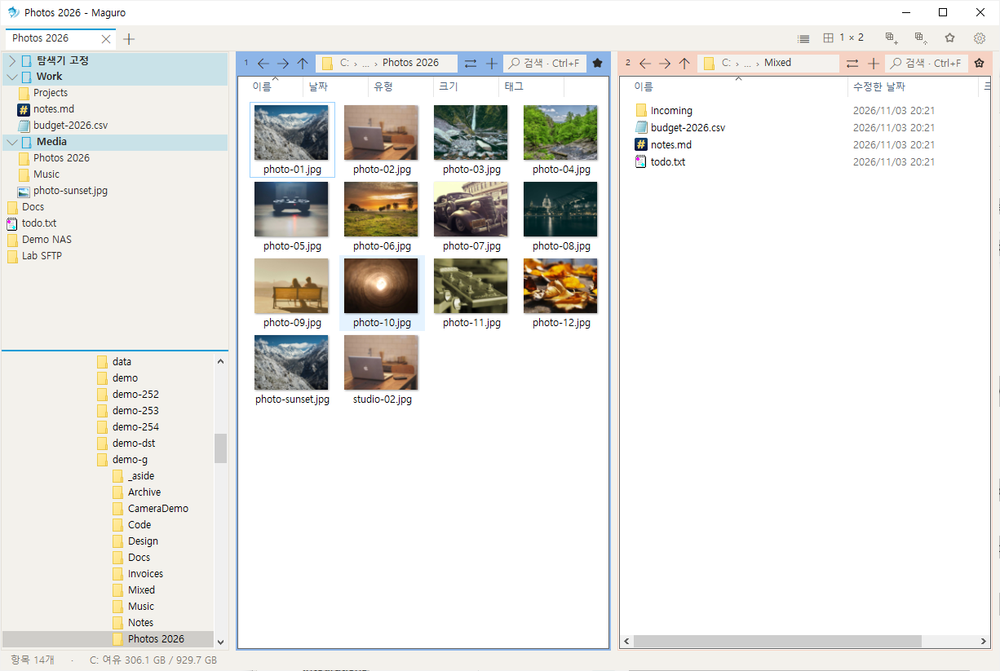
  </picture>

각 패널은 진짜 Windows 탐색기 보기입니다. 우클릭 메뉴, 끌어서 놓기, 썸네일, Windows 복사 대화상자가 그대로입니다. 새로 설치하면 **패널 하나**로 열립니다. 일이 커지면 격자를 넓히세요. 최대 4×4, 패널 열여섯 개입니다.

복사와 이동은 **IFileOperation**을 탑니다. Windows 진행 창, 실행 취소, 익숙한 충돌 확인이 그대로입니다. 네트워크 전송은 원할 때 robocopy로 바꿀 수 있습니다.

## 한눈에 보이는 배치

레이아웃을 누르면 고른 격자가 열립니다. 누르고 끌면 열마다 행 수를 정합니다. 구분선을 끌어 크기를 바꾸고, 두 번 클릭하면 균등하게 나눕니다. 패널 머리글을 두 번 클릭하거나 Ctrl+Shift+M을 누르면 그 패널만 커집니다.

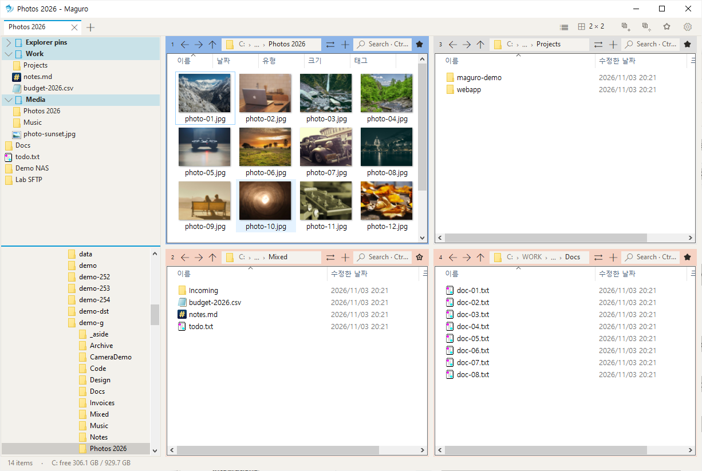

<table>
<tr>
<td>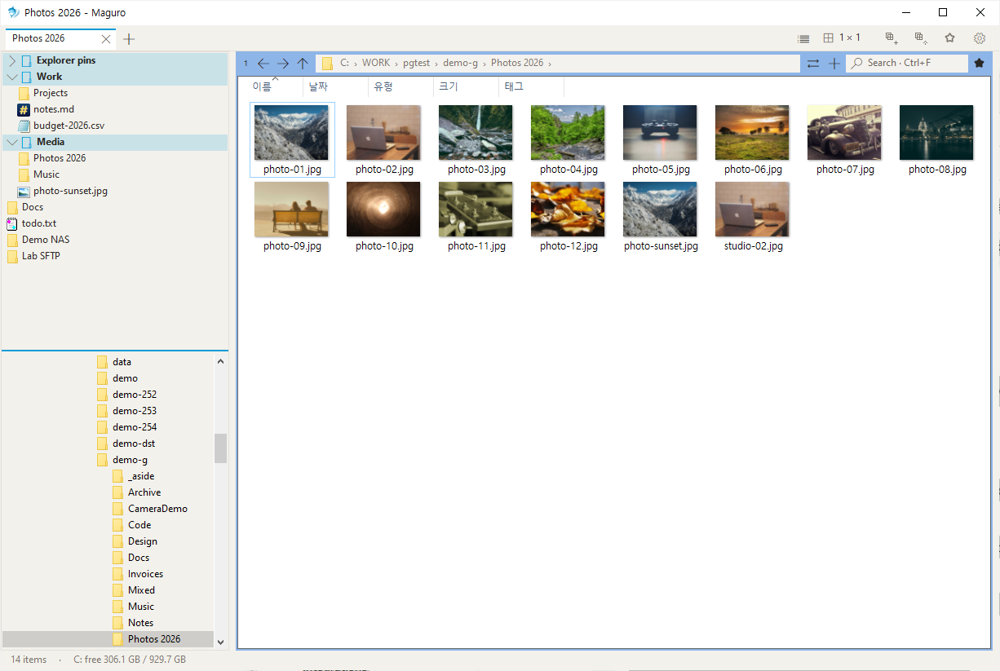</td>
<td>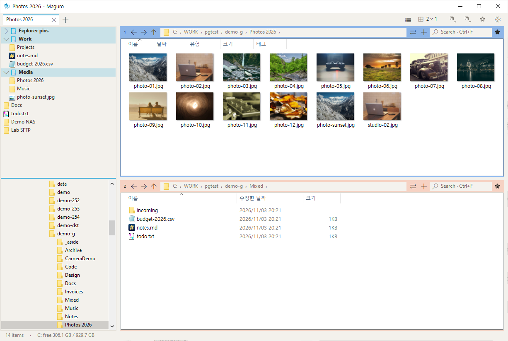</td>
<td>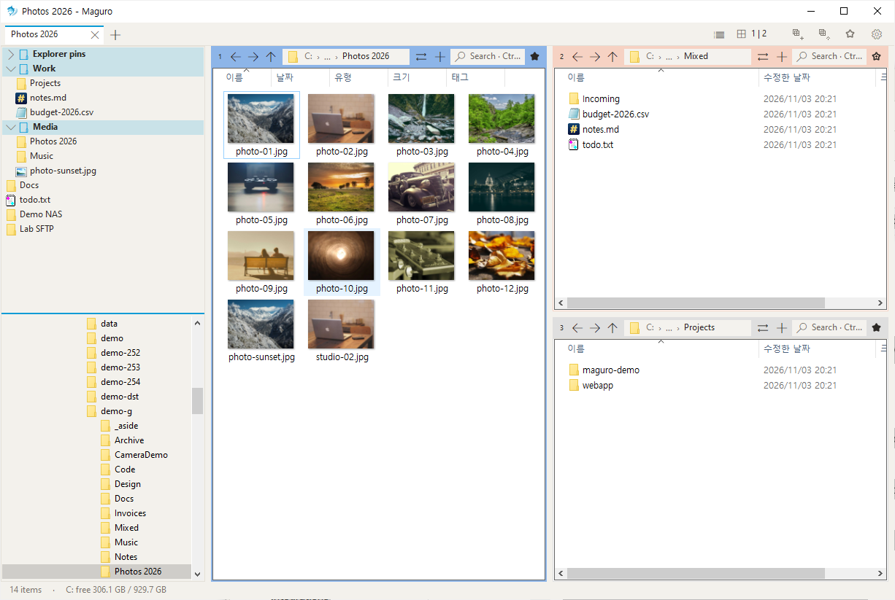</td>
</tr>
<tr>
<td>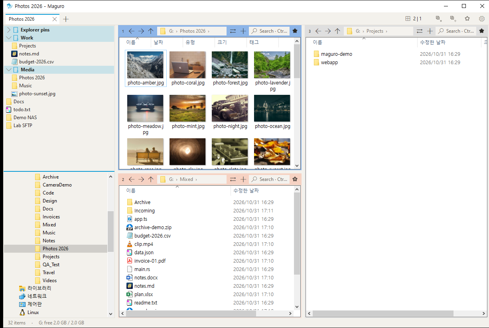</td>
<td>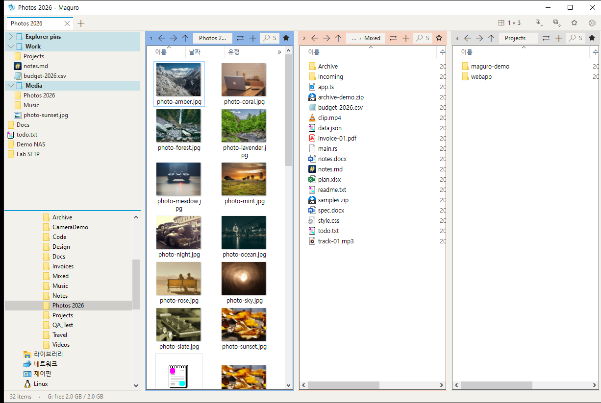</td>
<td>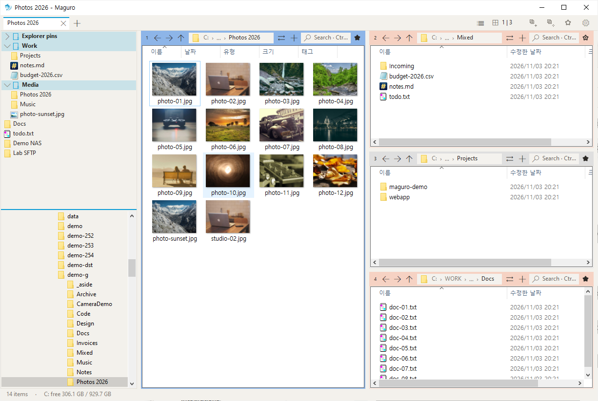</td>
</tr>
<tr>
<td>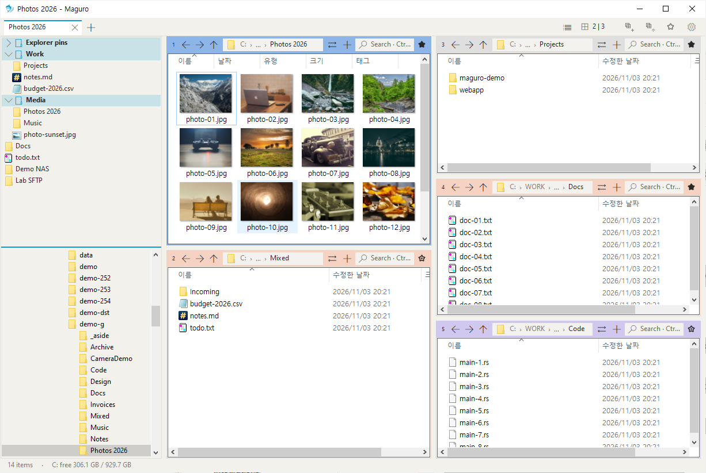</td>
<td>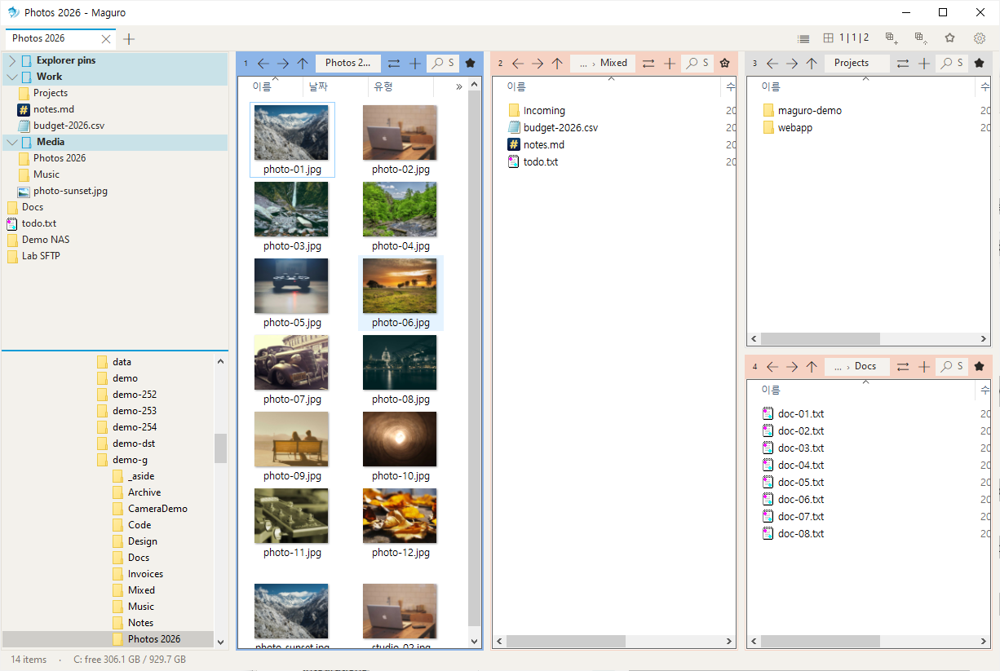</td>
<td>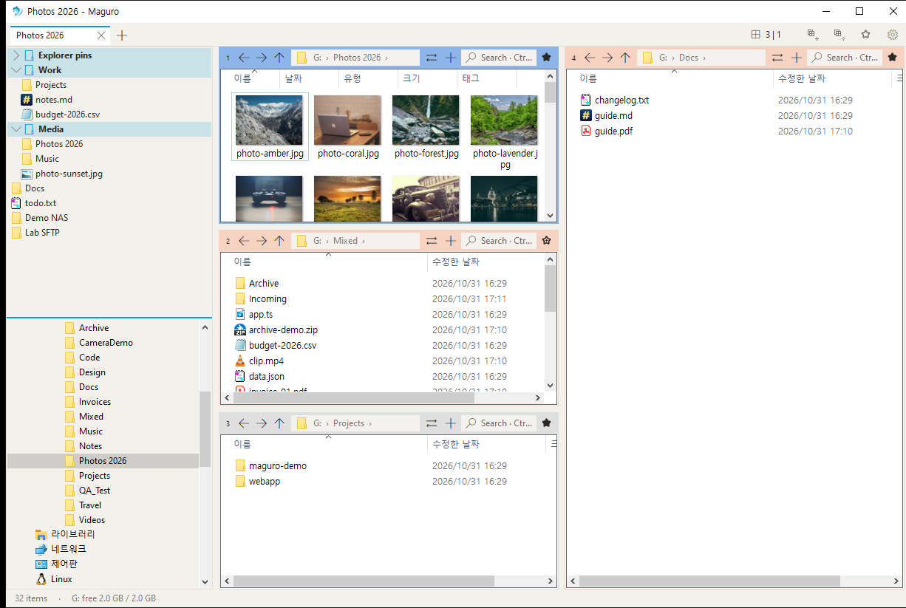</td>
</tr>
</table>

## 탭, 세션, 탭 목록

창 탭은 배치 전체를 담습니다. 패널, 폴더, 열, 색 라벨까지. 패널 탭은 한 칸 안의 폴더를 더 엽니다.

**Ctrl+Shift+L**은 이 창의 탭 목록을 엽니다. 탭 이름이나 폴더로 거르고 — 전체 경로도 맞습니다 — 폴더 칩에 마우스를 올리면 경로가 나오고, **F2**로 탭 이름을 바꾸고, Enter로 이동합니다. 탭 줄 끝의 목록 단추와 탭 메뉴의 **탭 목록…**도 같은 창입니다.

이름 있는 세션은 `maguro-sessions` 안의 **`.maguro` 파일**뿐입니다. `.grids`, `.qdr`, `grids.ini`는 열지 않습니다.

  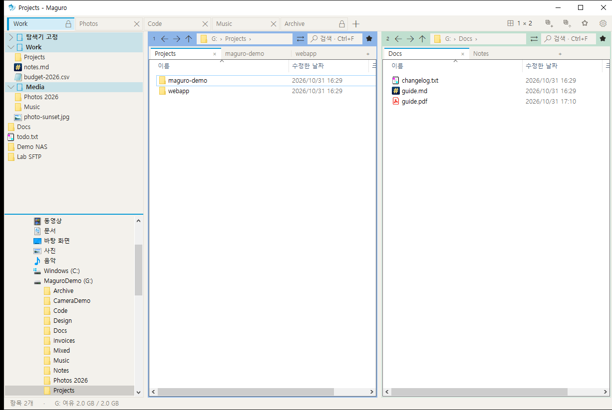
  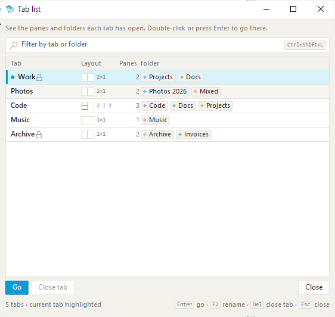

패널 번호 배지를 끌어 다른 패널과 자리를 바꿉니다. 끄는 동안 **Ctrl**을 누르면 그 패널을 복제합니다. 패널 머리글 색으로 원본과 대상을 구분하세요.

## 찾기, 미리 보기, 이름 바꾸기

**Ctrl+F**는 입력하는 대로 이 폴더를 거릅니다. 하위 폴더를 켜면 Maguro가 실행 중인 [voidtools Everything](https://www.voidtools.com/)에 묻고, Everything이 없으면 디스크를 직접 훑습니다. Everything 결과는 이름·경로·크기·수정한 날짜 표입니다. 열 경계를 끌면 폭이 바뀌고 maguro.json에 남습니다. 그 경계를 두 번 누르면 그 열이 기본 폭으로 돌아갑니다. 결과에 마우스를 올리면 전체 이름·폴더·정확한 크기·날짜가 다른 툴팁과 같이 바로 나타납니다.

**Space** 또는 **F3**는 빠른 보기를 엽니다. 그림, PDF, Office, HTML, Markdown, 코드, CSV, ZIP, HWP 등을 봅니다. Ctrl+휠은 10%에서 800%까지 확대합니다. 왼쪽·오른쪽 화살표로 파일을 넘깁니다. 미리 보기에서 **F2**는 이름을 바꾸고 **Del**은 삭제합니다.

**Ctrl+Shift+R**은 일괄 이름 바꾸기를 엽니다. 왼쪽에는 규칙이 쌓입니다. 바꾸기, 대소문자, 번호, 날짜, 정규식 등. 오른쪽 미리 보기는 적용 전에 새 이름과 부딪히는 이름을 모두 보여 줍니다. 실행 취소는 마지막 작업을 되돌립니다.

  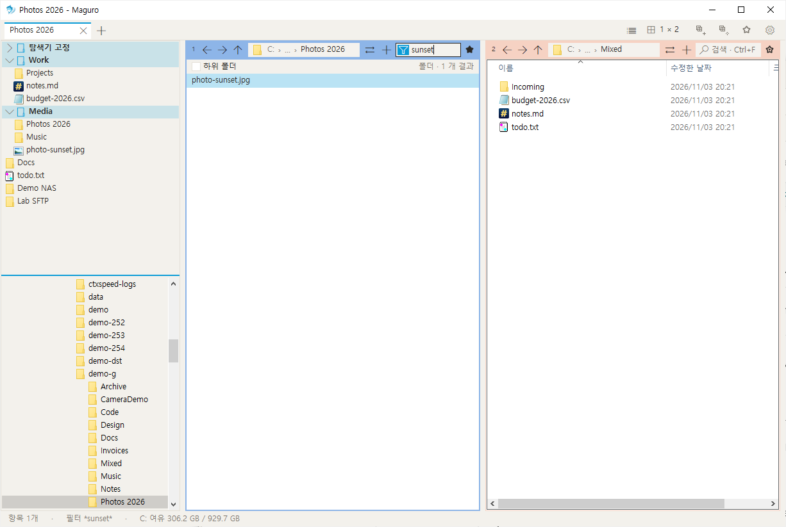
  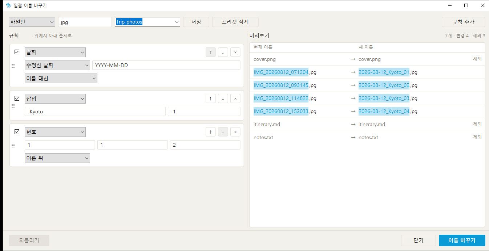

## Excel, 상황에 맞는 메뉴, Win+Shift+E

`.xlsx` 또는 `.xlsm`을 우클릭하고 **A1·100%로 정리**를 고르세요. 선택이 A1로, 확대/축소가 100%로 돌아가고, 첫 시트를 고르거나 `.bak.xlsx` 백업을 남길 수 있습니다. **읽기 모드로 열기**는 `.xls`, `.xlsx`, `.xlsm`, `.csv`를 Excel `/r`로 열어, 공유 통합 문서를 다른 사람이 계속 쓸 수 있게 합니다.

파일 목록은 탐색기 메뉴에 Maguro 항목이 더해집니다. Maguro 즐겨찾기에 추가, 일괄 이름 바꾸기, 고속 붙여넣기, 이 파일을 사용 중인 프로그램. 설정에서 타사 항목과 Windows 11 패키지 명령을 숨길 수 있습니다. 즐겨찾기는 왼쪽 패널의 그룹으로 두고, **Ctrl+B**가 빠른 목록을 엽니다.

**Win+Shift+E**는 Maguro가 실행 중일 때 어느 앱에서나 Maguro를 앞으로 가져옵니다. 한 번 더 누르면 단일 창 모드에서는 새 탭이 열리고, 그 모드를 끄면 Maguro가 최소화됩니다. Win+E는 탐색기 그대로입니다.

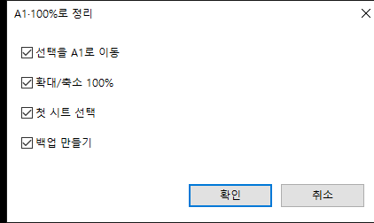

같은 창에 파일 바구니, 폴더 감시, 클립보드 경로 열기(Win+Shift+V), 작업 공간 아홉 개, SMB·WebDAV·SFTP·FTP 연결도 있습니다. [도움말](https://samek86.github.io/maguro/help/)에 각각과 모든 단축키·설정이 있습니다.

라이트와 다크는 Windows를 따르거나 직접 고릅니다. 기본 강조색은 세룰리언 `#0A9BD6`입니다. 인터페이스는 English, 한국어, 日本語, français, Deutsch로 제공됩니다.

## 설치

[릴리스](https://github.com/Samek86/maguro/releases/latest)에서 `maguro.exe`를 받아 아무 폴더에 두고 실행하세요. 릴리스는 그 exe와 `maguro.exe.sha256` 체크섬을 담고, zip은 없습니다.

exe는 코드 서명이 없어 처음 실행할 때 SmartScreen이 경고할 수 있습니다. **추가 정보 → 실행**을 고르세요.

**필요 환경:** Windows 10 버전 1903 이상 또는 Windows 11, x64. SFTP와 FTP에는 [rclone](https://rclone.org/)과 [WinFsp](https://winfsp.dev/)도 필요합니다. 연결을 추가할 때 Maguro가 설치를 제안할 수 있습니다.

설정은 `%APPDATA%\Maguro\maguro.json`에 있습니다. exe 옆에 `portable.txt`를 두면 `maguro.json`도 그 옆에 둡니다. 키 표는 [docs/settings.md](docs/settings.md)에 있습니다. 소스에서 빌드하려면 [CONTRIBUTING.ko.md](CONTRIBUTING.ko.md)를 보세요.

## 만든 사람

Maguro는 efww의 [efww/grids](https://github.com/efww/grids) 포크입니다.

[Q-Dir](https://www.softwareok.com/?seite=Freeware/Q-Dir)와 [voidtools Everything](https://www.voidtools.com/)에서 영감을 받았습니다. Maguro는 독립 프로젝트이며 Q-Dir이나 그 제작자와 관련이 없습니다.

## 라이선스

[MIT](LICENSE) · © 2026 efww, Samek86
