

  <picture>
    <source media="(prefers-color-scheme: dark)" srcset="assets/maguro-lockup-dark.png">
    <source media="(prefers-color-scheme: light)" srcset="assets/maguro-lockup-light.png">
    
  </picture>

<h1 align="center">Maguro</h1>

A fast multi-pane file manager for Windows. Real Explorer panes, side by side.

> **Maguro is a fork of [efww/grids](https://github.com/efww/grids) by efww.** It has its own exe (`maguro.exe`), window class, settings folder, and hotkey (Win+Shift+E).

  
  
  
  

  English | <a href="README.ja.md">日本語</a> | <a href="README.ko.md">한국어</a>

  <a href="https://samek86.github.io/maguro/help/en/">Online help</a>
  · <a href="https://samek86.github.io/maguro/help/ja/">日本語</a>
  · <a href="https://samek86.github.io/maguro/help/">한국어</a>

  <picture>
    <source media="(prefers-color-scheme: dark)" srcset="docs/images-v3/hero_dark.png">
    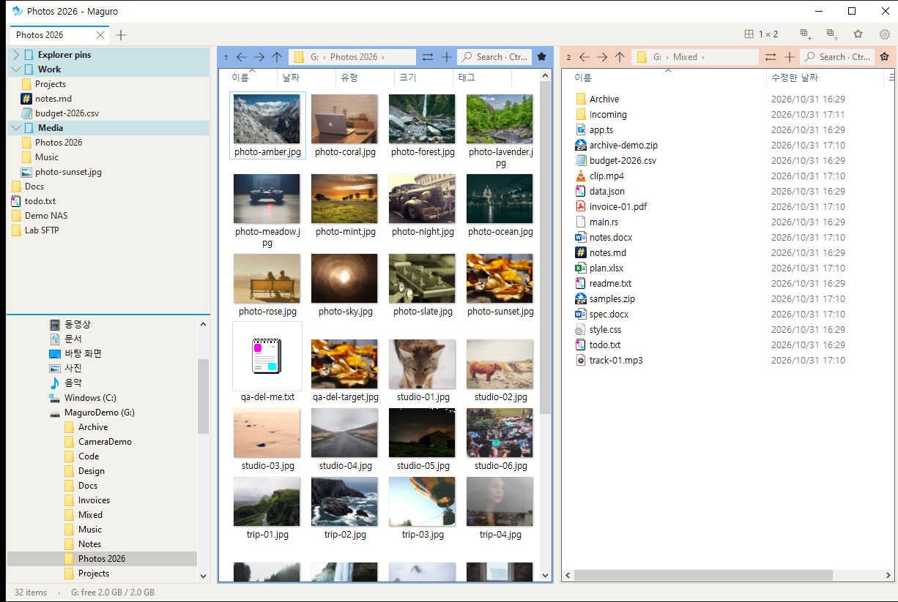
  </picture>

Each pane is a real Windows Explorer view. The right-click menu, drag and drop, thumbnails, and the Windows copy dialog are the ones you already know. A new install opens on **one pane**. Grow the grid when the job needs more room — up to 4×4, sixteen panes.

Copy and move go through **IFileOperation**, so you get the Windows progress window, undo, and the usual conflict prompts. Network transfers can switch to robocopy when you want them to.

## Layouts you can see at a glance

Click Layout for an even grid, or press and drag to set how many rows each column gets. Drag a splitter to resize. Double-click it to split evenly. Double-click a pane header, or press Ctrl+Shift+M, to maximise that pane.

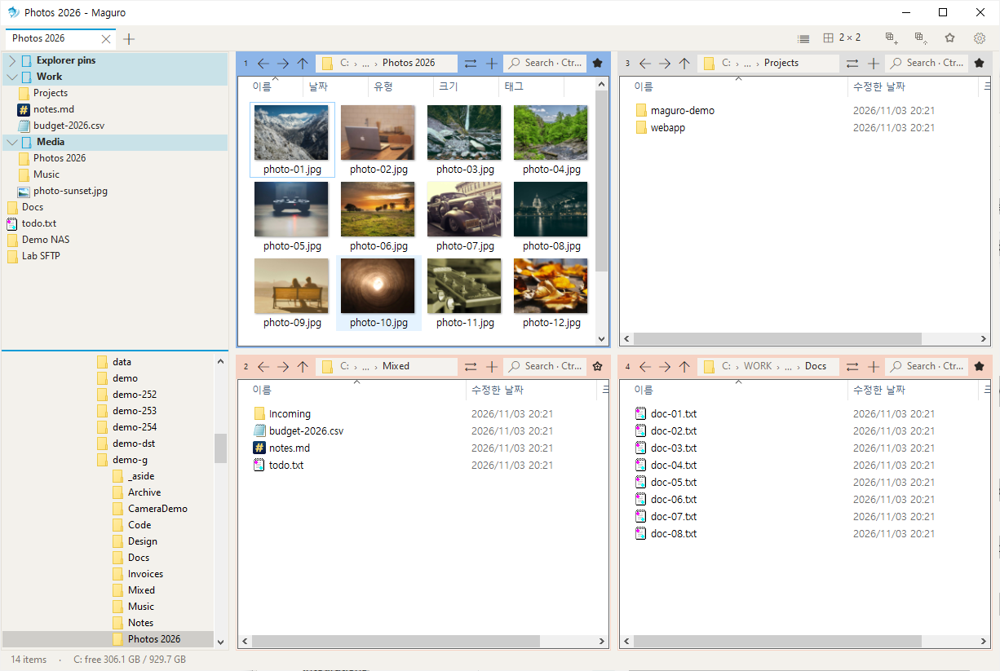

<table>
<tr>
<td>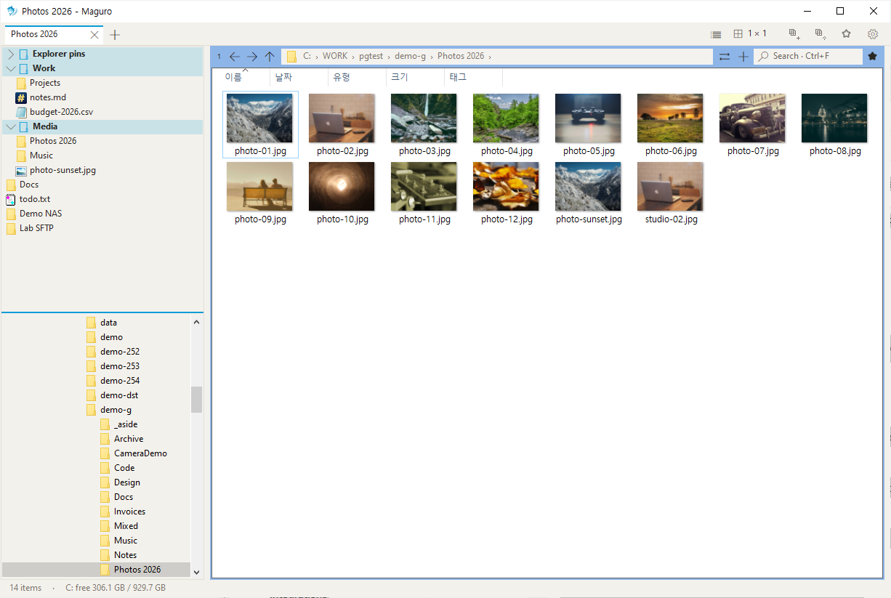</td>
<td>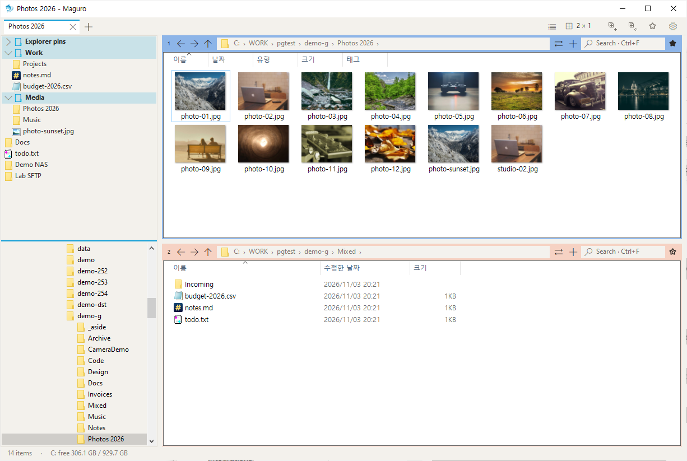</td>
<td>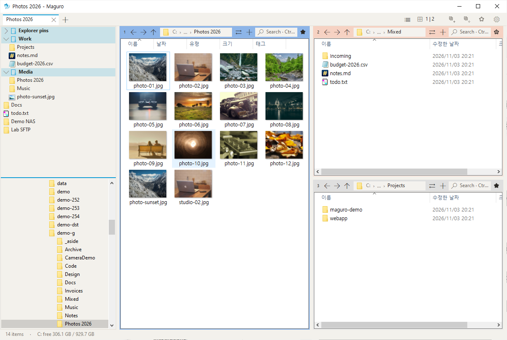</td>
</tr>
<tr>
<td>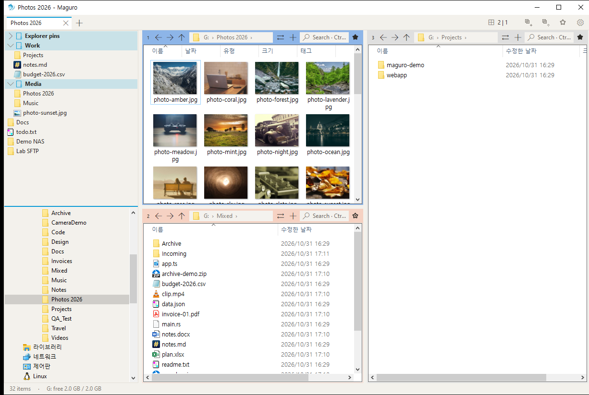</td>
<td>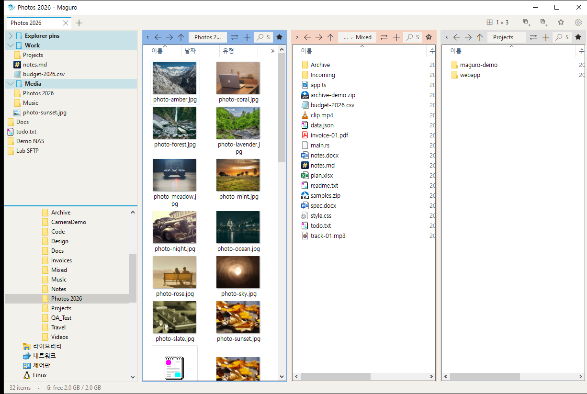</td>
<td>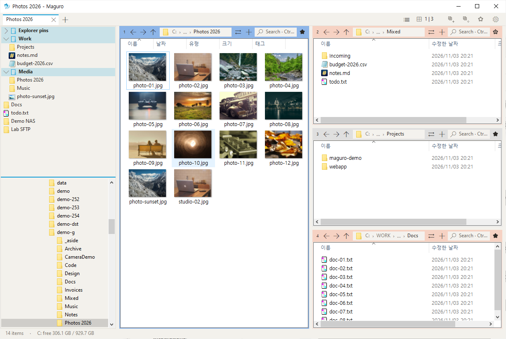</td>
</tr>
<tr>
<td>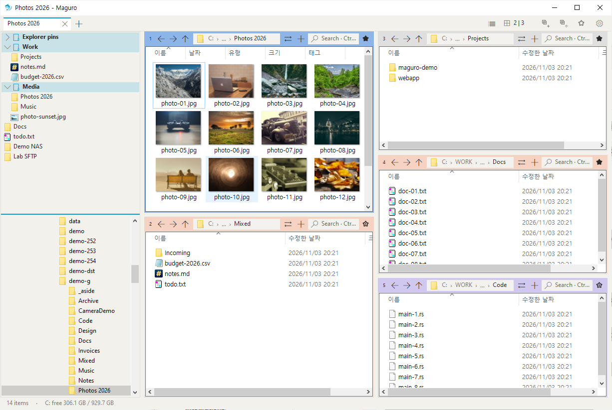</td>
<td>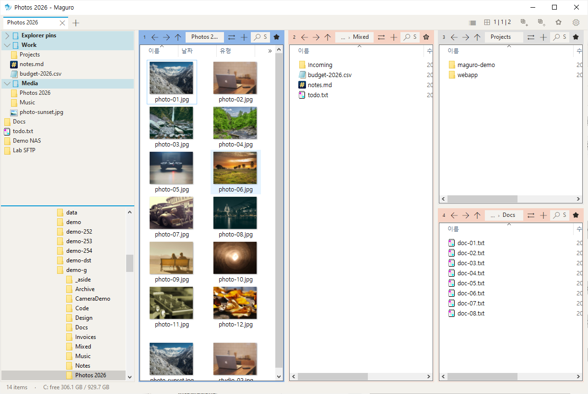</td>
<td>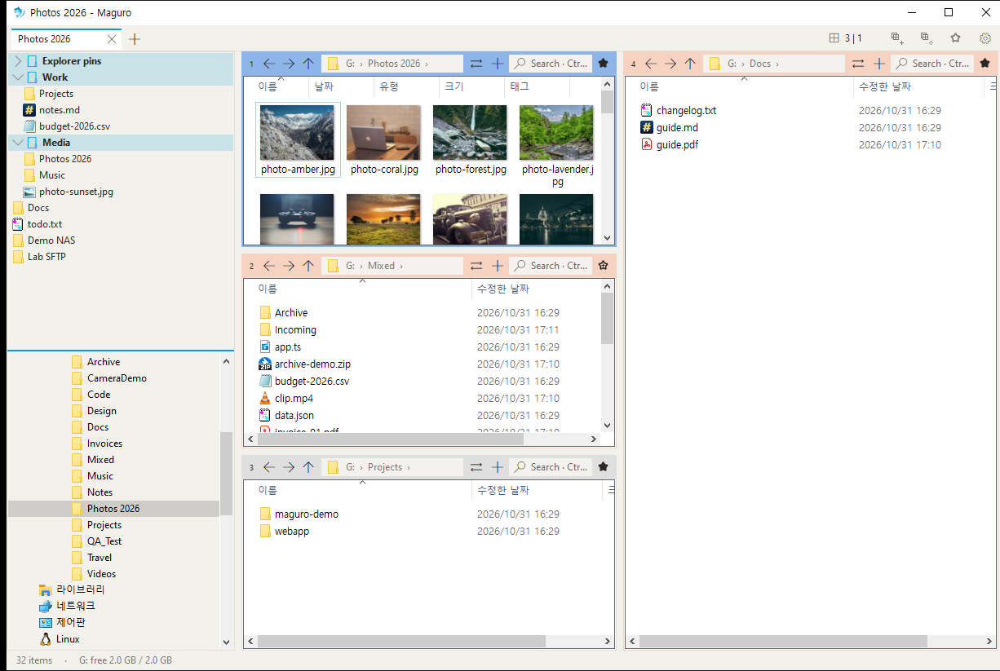</td>
</tr>
</table>

## Tabs, saved sessions, and a tab list

Window tabs hold a whole layout: panes, folders, columns, and colour labels. Pane tabs are extra folders inside one cell.

**Ctrl+Shift+L** opens the tab list for this window. Filter by tab name or folder — the search also matches the full path — hover a folder chip for that path, press **F2** to rename the tab, and press Enter to jump. The list button at the end of the tab row, and **Tab list…** on the tab menu, open the same window.

Named sessions are **`.maguro` files** in `maguro-sessions`. Maguro does not open `.grids`, `.qdr`, or `grids.ini`.

  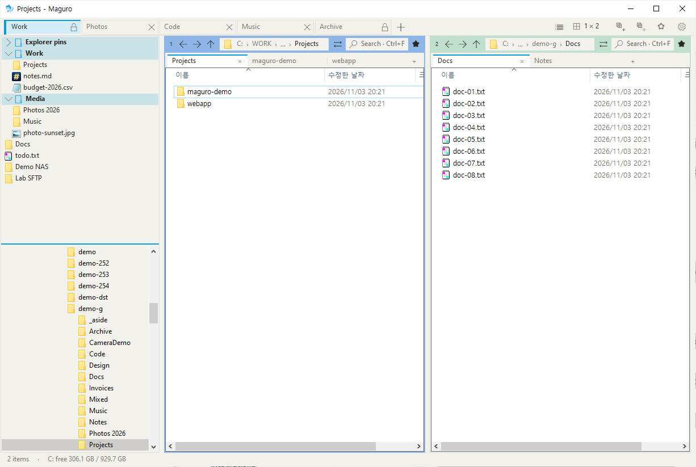
  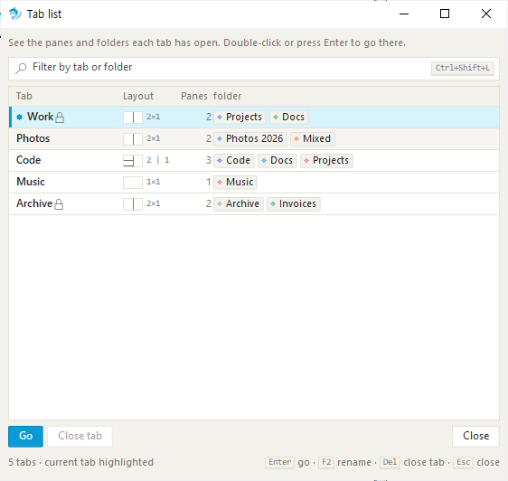

Drag a pane by its number to swap it with another. Hold **Ctrl** while you drag to duplicate that pane instead. A colour on the pane header keeps source and destination obvious.

Drag files or folders from a pane, the file basket, or Explorer, and rest on another window tab or on a pane tab for about half a second. That tab opens, the way a browser tab does. Drop on a pane there to copy or move: the same drive moves, another drive copies, Ctrl copies, Shift moves. The Windows progress window runs on its own thread. Dropping on the tab itself puts the items in that tab's active folder when the drop is a plain set of files and the folder is a real one. Otherwise the tab only opens. Dragging a window tab along the row still reorders it.

## Find, preview, rename

**Ctrl+F** filters the folder as you type. Tick Subfolders and Maguro asks [voidtools Everything](https://www.voidtools.com/) when it is running, or walks the disk when it is not. Everything results are a table of name, path, size and date modified: drag a column border to resize it (kept in maguro.json; double-click that border to restore the column's default width) and hover a row for the full name, folder, exact size and date, in the same tooltip as the rest of Maguro.

**Space** or **F3** opens Quick Look: pictures, PDF, Office, HTML, Markdown, code, CSV, ZIP, HWP, and more. Ctrl+wheel zooms from 10% to 800%. Left and Right step through the files. From the preview, **F2** renames and **Del** deletes.

**Ctrl+Shift+R** opens Batch Rename. Rules stack on the left — replace, case, numbering, dates, regex, and more — and a live preview on the right shows every new name, and every name that would clash, before you commit. Undo puts the last batch back.

  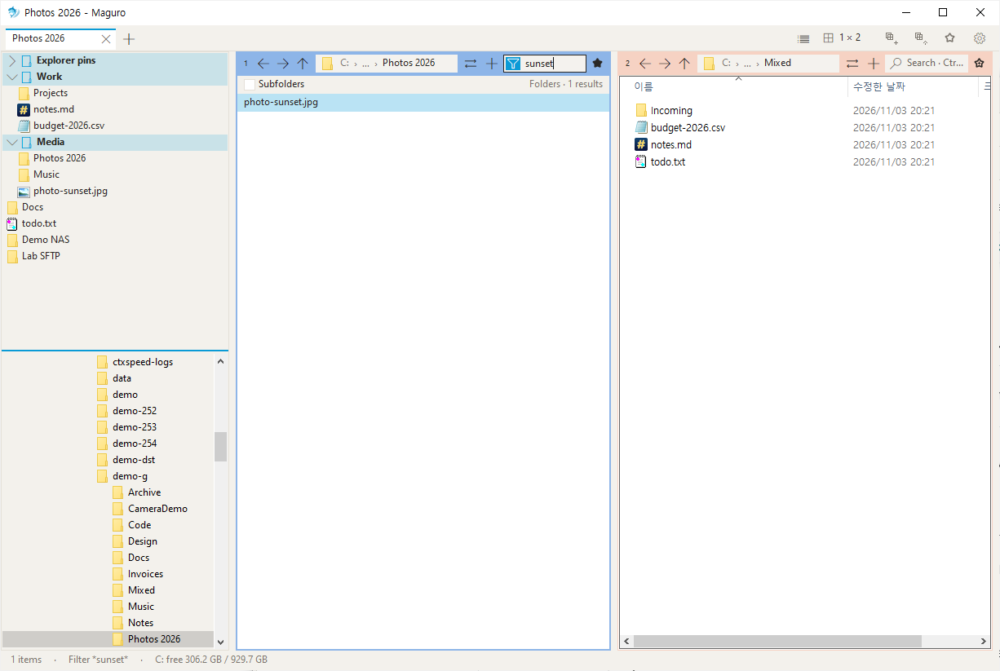
  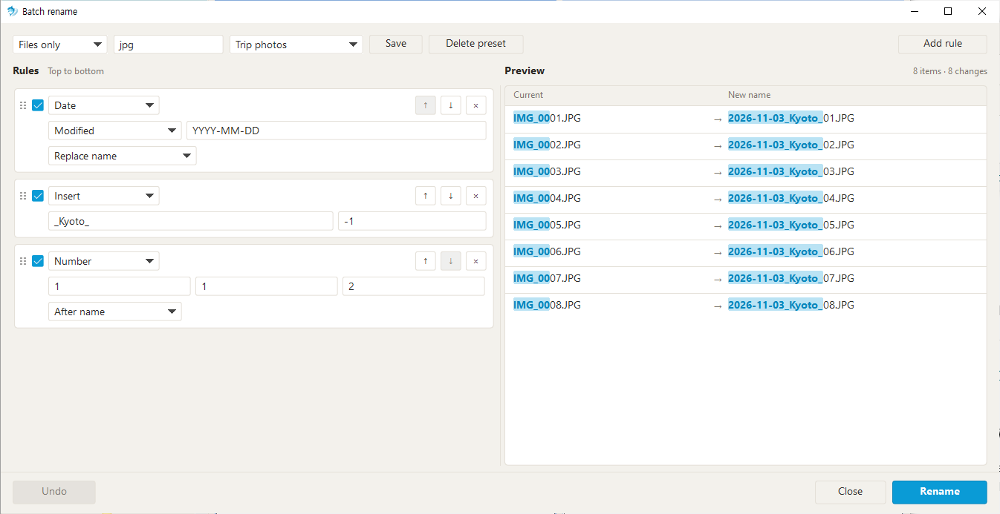

## Excel, the context menu, and Win+Shift+E

Right-click `.xlsx` or `.xlsm` and choose **Tidy to A1 · 100%**. Selection returns to A1, zoom to 100%, and you can activate the first sheet and keep a `.bak.xlsx`. **Open read-only** launches Excel with `/r` for `.xls`, `.xlsx`, `.xlsm`, and `.csv`, so a shared workbook stays unlocked for everyone else.

The file list is Explorer’s menu, plus Maguro rows: add to Maguro favourites, batch rename, Fast paste, and who is using this file. Settings can hide third-party items and the Windows 11 packaged commands. Favourites live in the left panel, in groups, and **Ctrl+B** opens the quick list.

**Win+Shift+E** brings Maguro forward from any app while it is running. Press it again and a single window opens a new tab; with single-window mode off, Maguro minimises. Win+E stays with Explorer.

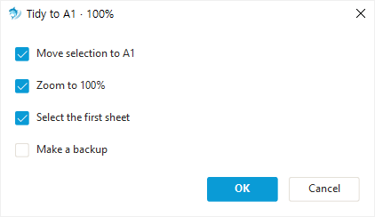

The same window also keeps a file basket, folder watch, clipboard-path open (Win+Shift+V), nine workspaces, and SMB, WebDAV, SFTP, and FTP connections. The [help](https://samek86.github.io/maguro/help/en/) documents each one, plus every shortcut and setting.

Light and dark follow Windows, or you can pick one. The default accent is cerulean `#0A9BD6`. The interface ships in English, 한국어, 日本語, français, and Deutsch.

## Install

Download `maguro.exe` from [Releases](https://github.com/Samek86/maguro/releases/latest). Put it anywhere and run it. Releases ship that exe and a `maguro.exe.sha256` checksum, not a zip.

The exe is not code-signed, so SmartScreen may warn the first time. Choose **More info → Run anyway**.

**Requires** Windows 10 version 1903 or later, or Windows 11, x64. SFTP and FTP also need [rclone](https://rclone.org/) and [WinFsp](https://winfsp.dev/). Maguro can offer to install them when you add a connection.

Settings live in `%APPDATA%\Maguro\maguro.json`. A `portable.txt` file next to the exe keeps `maguro.json` beside it. The key table is in [docs/settings.md](docs/settings.md). To build from source, see [CONTRIBUTING.md](CONTRIBUTING.md).

## Credits

Maguro is a fork of [efww/grids](https://github.com/efww/grids) by efww.

Inspired by [Q-Dir](https://www.softwareok.com/?seite=Freeware/Q-Dir) and [voidtools Everything](https://www.voidtools.com/). Maguro is an independent project and is not affiliated with Q-Dir or its author.

## License

[MIT](LICENSE) · © 2026 efww, Samek86
